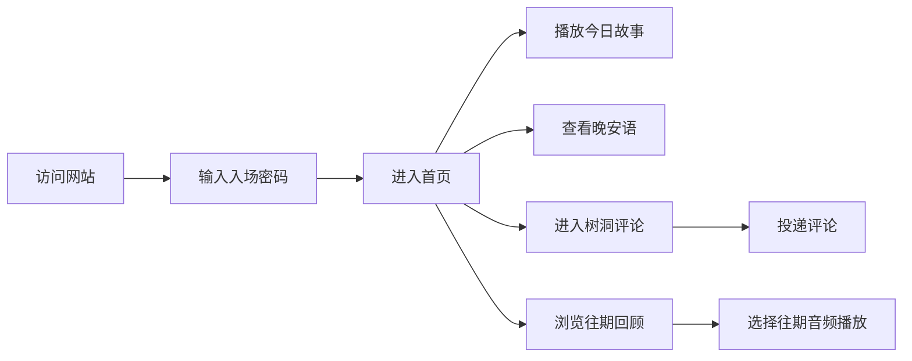

## 1. 产品概述

小提星空广播站是一个治愈系睡前故事网站，为抑郁症患者和需要心理慰藉的用户提供温暖的睡前音频陪伴。每晚一颗"星辰"，一封"声音情书"，用温柔的声音陪伴用户入眠。

* **核心价值**：深夜治愈、温暖陪伴、极简体验

* **目标用户**：需要心理慰藉的人群，特别是抑郁症患者

* **产品定位**：私密、专属、治愈的睡前音频空间

## 2. 核心功能

### 2.1 用户角色

| 角色 | 进入方式 | 核心权限           |
| -- | ---- | -------------- |
| 访客 | 入场密码 | 收听故事、投递评论、查看往期 |

### 2.2 功能模块

1. **入场页**：星空密码输入界面，营造神秘感和专属感
2. **首页（那一晚的星光）**：今日音频播放器、晚安语、播放动效
3. **往期回顾（时光留声机）**：往期音频卡片列表，按日期排列
4. **树洞评论区**：温暖的评论互动，投递式输入体验

### 2.3 页面详情

| 页面名称  | 模块名称  | 功能描述                 |
| ----- | ----- | -------------------- |
| 入场页   | 密码输入  | 输入专属密码进入广播站，星空背景动画   |
| 首页    | 今日播放器 | 巨大的暖色调播放按钮，进度条，呼吸灯效果 |
| 首页    | 晚安语   | 今日专属晚安文案，温暖陪伴        |
| 首页    | 导航入口  | 往期回顾、返回首页的极简导航       |
| 往期回顾  | 音频卡片墙 | 瀑布流卡片，显示日期和标题，点击可播放  |
| 树洞评论区 | 评论列表  | 温暖的评论展示，类似漂流瓶/许愿池    |
| 树洞评论区 | 评论输入  | "放入树洞"按钮，治愈系提示文案     |

## 3. 核心流程

用户访问网站 → 输入入场密码 → 进入首页看到今日星光 → 点击播放按钮收听故事 → 滚动查看晚安语 → 进入树洞投递心情 → 浏览往期回顾

## 4. 用户界面设计

### 4.1 设计风格

* **主色调**：深邃星空蓝 `#0a1628`，渐变至 `#1a2a4a`

* **暖色调**：暖黄微光 `#ffd89b`，暖橙 `#f5a623`

* **中性色**：米白 `#f5f0e8`，暖灰 `#8a8a8a`，深灰 `#2a2a3a`

* **按钮风格**：圆润柔和，带有微弱发光效果，无尖锐边角

* **字体选择**：标题使用优雅衬线字体，正文使用圆润无衬线字体

* **布局风格**：大面积留白，居中对称，呼吸感十足

* **动效风格**：缓慢柔和，呼吸灯、星光闪烁，无快速闪烁

### 4.2 页面设计概述

| 页面名称  | 模块名称 | UI 元素                  |
| ----- | ---- | ---------------------- |
| 入场页   | 密码输入 | 星空背景、闪烁星星、柔和输入框、温暖光晕按钮 |
| 首页    | 播放器  | 巨大圆形播放按钮、暖黄色进度条、呼吸灯动效  |
| 首页    | 晚安语  | 优雅排版、渐显动画、温暖色调         |
| 往期回顾  | 卡片墙  | 半透明卡片、悬停微亮、日期编号        |
| 树洞评论区 | 评论列表 | 气泡式评论、柔和阴影、错落排列        |
| 树洞评论区 | 输入区  | 圆润输入框、"放入树洞"按钮、温馨提示    |

### 4.3 响应式

* 桌面端优先设计，移动端自适应

* 播放器在移动端保持居中突出

* 评论区单列滚动，适配触摸操作

* 导航在移动端转为底部或汉堡菜单

### 4.4 视觉细节指引

* **星空背景**：多层视差星星，缓慢闪烁，营造深度感

* **呼吸灯效果**：播放时按钮周围有微弱的光晕脉动

* **入场动画**：页面元素渐次显现，如星光缓缓亮起

* **滚动动效**：元素随滚动淡入，平滑过渡

* **按钮交互**：悬停时微微放大并发光，点击时有温柔的反馈

