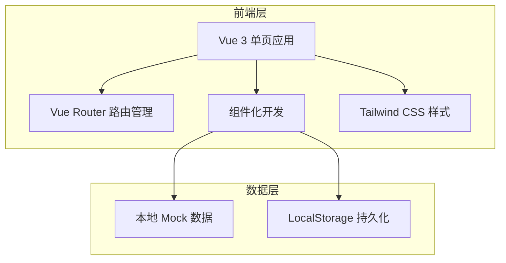

## 1. 架构设计

本项目为纯前端单页应用，使用 Vue 3 + TypeScript + Tailwind CSS 构建，无需后端服务，数据使用本地 mock 数据。



## 2. 技术描述

- **前端框架**：Vue 3 + TypeScript + Vite
- **路由管理**：Vue Router 4
- **样式方案**：Tailwind CSS 3
- **初始化工具**：vite-init（vue-ts 模板）
- **后端**：无（纯前端项目）
- **数据库**：无，使用 LocalStorage 存储评论数据
- **图标**：Lucide Vue Next

## 3. 路由定义

| 路由 | 页面 | 说明 |
|------|------|------|
| `/` | 入场页 | 密码输入界面 |
| `/home` | 首页 | 今日播放器 + 晚安语 + 树洞评论 |
| `/archive` | 往期回顾 | 历史音频卡片列表 |

## 4. 数据模型

### 4.1 音频故事数据

```typescript
interface Story {
  id: number
  title: string
  subtitle: string
  date: string
  starNumber: number
  audioUrl: string
  duration: string
  goodnightText: string
}
```

### 4.2 评论数据

```typescript
interface Comment {
  id: number
  storyId: number
  content: string
  createdAt: string
  avatar?: string
}
```

### 4.3 Mock 初始数据

- 预置 5-7 条往期故事数据
- 预置几条温暖的示例评论
- 默认入场密码：`xiaoti`（可配置）

## 5. 组件结构

```
src/
├── components/
│   ├── StarryBackground.vue   # 星空背景组件
│   ├── AudioPlayer.vue        # 主播放器组件
│   ├── CommentSection.vue     # 树洞评论区
│   ├── StoryCard.vue          # 往期故事卡片
│   └── NavBar.vue             # 极简导航栏
├── views/
│   ├── EntryPage.vue          # 入场密码页
│   ├── HomePage.vue           # 首页
│   └── ArchivePage.vue        # 往期回顾页
├── composables/
│   └── useAudioPlayer.ts      # 播放器逻辑
├── data/
│   └── stories.ts             # Mock 故事数据
├── router/
│   └── index.ts               # 路由配置
├── App.vue
└── main.ts
```

## 6. 核心交互实现

### 6.1 星空背景
- 使用 CSS 动画 + 多层背景实现闪烁星星
- 通过伪元素和 radial-gradient 创建星点
- 不同层级星星以不同速度闪烁

### 6.2 播放器
- 使用原生 `<audio>` 元素
- 自定义播放按钮样式，带呼吸灯动效
- 自定义进度条，暖黄色调
- 播放状态切换动画

### 6.3 评论系统
- LocalStorage 持久化存储
- 评论渐入动画
- "放入树洞"提交动效

### 6.4 入场密码
- 简单的前端密码验证
- 验证通过后存储状态到 sessionStorage
- 错误时温柔的抖动反馈
